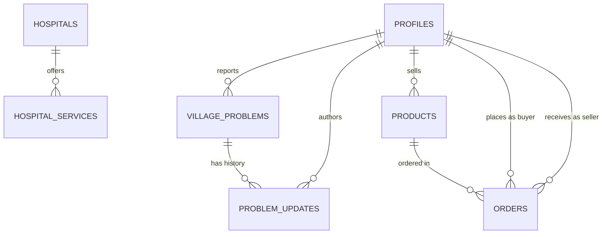

# 🌾 Gram Mitra (Rural Connect) — Backend API Service

[](https://nodejs.org/)
[](https://expressjs.com/)
[](https://supabase.com/)
[](https://www.docker.com/)
[](https://kubernetes.io/)
[](https://www.jenkins.io/)
[](https://jestjs.io/)

A production-ready, modular RESTful backend powering **Gram Mitra (Rural Connect)** — a comprehensive digital empowerment platform designed for rural citizens, farmers, and village communities. Built with **Node.js, Express, JavaScript, and Supabase PostgreSQL**, following a clean, layered architecture with robust error handling, security policies, and DevOps pipelines.

---

## 📑 Table of Contents

- [Vision & Core Modules](#-vision--core-modules)
- [Architecture & Folder Structure](#-architecture--folder-structure)
- [Tech Stack](#-tech-stack)
- [Database Architecture & Schema](#-database-architecture--schema)
- [Environment Configuration](#-environment-configuration)
- [Quick Start & Local Setup](#-quick-start--local-setup)
- [API Reference Guide](#-api-reference-guide)
  - [1. System & Health Check](#1-system--health-check)
  - [2. Authentication & User Profile](#2-authentication--user-profile)
  - [3. Healthcare & Veterinary Directory](#3-healthcare--veterinary-directory)
  - [4. Village Problem Redressal](#4-village-problem-redressal)
  - [5. Government Schemes & Beneficiaries](#5-government-schemes--beneficiaries)
  - [6. Farmer Marketplace & Orders](#6-farmer-marketplace--orders)
  - [7. Partner NGOs Directory](#7-partner-ngos-directory)
  - [8. Myth vs Fact (Superstition Buster)](#8-myth-vs-fact-superstition-buster)
  - [9. AI Voice Mentor (Vapi Integration)](#9-ai-voice-mentor-vapi-integration)
- [Response & Error Formats](#-response--error-formats)
- [Testing Suite](#-testing-suite)
- [DevOps, Docker & Kubernetes](#-devops-docker--kubernetes)
- [Jenkins CI/CD Automation](#-jenkins-cicd-automation)
- [Troubleshooting & FAQs](#-troubleshooting--faqs)

---

## 🌟 Vision & Core Modules

Gram Mitra bridges the critical digital gap for rural India with essential services accessible over responsive web and mobile interfaces:

1. **🏥 Rural Healthcare & Veterinary Network**: Find human hospitals (PHCs, CHCs, Civil Hospitals) and veterinary clinics, query clinical services, search nearby facilities using real-time GPS coordinates (Haversine formula), and access 24/7 emergency helplines (`108`, `102`, `104`, `1962`, `112`).
2. **📢 Village Grievance Redressal**: Citizens can report infrastructure or community issues (drinking water, roads, power, sanitation) with geo-location, track priority levels, and audit chronological status update trails.
3. **🏛️ Government Schemes Integration**: Live data feed from **data.gov.in** PM-KISAN dataset with resilient in-memory caching, curated directories of major rural welfare programs (PMAY-G, MGNREGA, PMFBY, Ayushman Bharat), and eligibility breakdowns.
4. **🌾 Farmer Produce Marketplace**: Peer-to-peer farmer trading eliminating middlemen. List crops/produce, browse categories with price filters, place orders with inventory deduction, and manage fulfillment stages.
5. **🤝 Verified Partner NGOs Directory**: Connect rural families with accredited NGOs working across agricultural training, education, animal welfare, and women empowerment.
6. **💡 Myth vs Fact (Superstition Buster)**: Debunk prevalent rural myths, health misconceptions, and agricultural superstitions with verified scientific facts and authority citations.
7. **🎙️ AI Voice Mentor**: Voice AI assistant powered by Vapi Web SDK for voice queries, agricultural advisories, and bilingual assistance for low-literacy users.

---

## 📁 Architecture & Folder Structure

The project follows a **Clean Layered Architecture** separating routing, business logic, persistence, and external service communication:

```text
backend/
├── src/
│   ├── server.js               # Entry point, HTTP listener & graceful shutdown handlers
│   ├── app.js                  # Express app setup, CORS, Helmet, Morgan, and route mounting
│   ├── config/
│   │   ├── index.js            # Environment config parser with validation & defaults
│   │   └── supabase.js         # Supabase client instantiation (anon + service role)
│   ├── controllers/            # Request handlers, input validation, and response formatting
│   │   ├── auth.controller.js          # Registration, login, profile management
│   │   ├── health.controller.js        # Uptime and health check logic
│   │   ├── healthcare.controller.js    # Hospitals, veterinary, and clinical services
│   │   ├── marketplace.controller.js   # Products, categories, and order workflows
│   │   ├── ngo.controller.js           # Partner NGO directory & metrics
│   │   ├── problem.controller.js       # Citizen problem reporting & update timeline
│   │   ├── scheme.controller.js        # data.gov.in integration & scheme catalog
│   │   ├── superstition.controller.js  # Myth vs Fact catalog & verification
│   │   └── voice.controller.js         # Vapi AI mentor session, webhooks & logs
│   ├── routes/                 # Express Router module definitions (mounted at /api/v1)
│   │   ├── index.js            # Master router aggregating all modular sub-routes
│   │   ├── auth.routes.js              # /api/v1/auth
│   │   ├── health.routes.js            # /api/v1/health
│   │   ├── healthcare.routes.js        # /api/v1/healthcare
│   │   ├── marketplace.routes.js       # /api/v1/marketplace
│   │   ├── ngo.routes.js               # /api/v1/ngos
│   │   ├── problem.routes.js           # /api/v1/village-problems
│   │   ├── scheme.routes.js            # /api/v1/schemes
│   │   ├── superstition.routes.js      # /api/v1/superstitions
│   │   └── voice.routes.js             # /api/v1/voice
│   ├── services/               # Core business logic & external API communication
│   │   ├── healthcare.service.js       # Facilities spatial search & catalog logic
│   │   ├── marketplace.service.js      # Produce catalog, stock lock & order state
│   │   ├── ngo.service.js              # NGO filtering and contact registry
│   │   ├── problem.service.js          # Problem lifecycle, audit trail & stats
│   │   ├── scheme.service.js           # data.gov.in fetcher, memory cache & fallbacks
│   │   └── voice.service.js            # Vapi session config & webhook processor
│   ├── models/
│   │   └── index.js            # Supabase table definition references
│   ├── middleware/             # Express middlewares
│   │   ├── auth.middleware.js          # JWT & Supabase auth (requireAuth / optionalAuth)
│   │   ├── errorHandler.js             # Centralized global error handling middleware
│   │   └── notFound.js                 # 404 handler for unmapped endpoints
│   ├── utils/                  # Cross-cutting utilities
│   │   ├── logger.js                   # Colorized structured console logger
│   │   └── response.js                 # Unified sendSuccess & sendError response formatters
│   ├── db/
│   │   └── schema.sql          # Complete PostgreSQL DDL (tables, indexes, triggers)
│   └── scripts/
│       └── test-db.js          # Database connectivity & table existence check script
├── tests/                      # Automated Jest & Supertest integration test suites
│   ├── auth.test.js
│   ├── health.test.js
│   ├── healthcare.test.js
│   ├── marketplace.test.js
│   ├── ngo.test.js
│   ├── problem.test.js
│   ├── schemes.test.js
│   └── superstition.test.js
├── k8s/                        # Kubernetes production deployment manifests
│   ├── configmap.yaml          # ConfigMap for runtime app properties
│   ├── deployment.yaml         # Deployment with readiness & liveness probes
│   ├── secret.yaml             # K8s Secrets for credentials & tokens
│   └── service.yaml            # LoadBalancer/NodePort service definition
├── Dockerfile                  # Multi-stage lightweight Node Alpine container build
├── docker-compose.yml          # Standalone Docker Compose runner
├── docker-compose.jenkins.yml  # Dedicated runner for Jenkins CI environment
├── Jenkinsfile                 # End-to-end 7-stage CI/CD automated pipeline
├── .env.example                # Sample environment template
├── package.json                # Dependencies, scripts, and project metadata
└── README.md                   # This documentation
```

---

## 🛠️ Tech Stack

- **Runtime**: [Node.js](https://nodejs.org/) (v18.x or v20.x recommended, Docker uses Node 22-Alpine)
- **Framework**: [Express.js](https://expressjs.com/) (v4.21.2)
- **Database & Auth**: [Supabase](https://supabase.com/) (PostgreSQL 15+, Row-Level Security, Supabase Auth)
- **Security & Headers**: [Helmet](https://helmetjs.github.io/), [CORS](https://github.com/expressjs/cors)
- **Logging**: [Morgan](https://github.com/expressjs/morgan) (HTTP traffic) + Custom Structured Logger
- **Voice AI Agent**: [Vapi AI](https://vapi.ai/) Web SDK & Webhook handlers
- **External Public API**: [Open Government Data (OGD) Platform India](https://data.gov.in)
- **Testing**: [Jest](https://jestjs.io/) (v29.7) & [Supertest](https://github.com/ladjs/supertest)
- **Containerization**: [Docker](https://www.docker.com/) & [Docker Compose](https://docs.docker.com/compose/)
- **Orchestration**: [Kubernetes (k8s)](https://kubernetes.io/) / [Minikube](https://minikube.sigs.k8s.io/)
- **CI/CD**: [Jenkins](https://www.jenkins.io/) Declarative Pipeline

---

## 🗄️ Database Architecture & Schema

The persistence layer uses **PostgreSQL hosted on Supabase**. All table definitions, foreign keys, cascades, performance indexes, and automatic timestamp update triggers are maintained in [`src/db/schema.sql`](file:///c:/Users/kirve/OneDrive/Desktop/gram-mitra/backend/src/db/schema.sql).

### Entity Relationship Summary



### Table Specifications

| Table | Primary Key | Description & Key Columns |
|---|---|---|
| `profiles` | `id` (UUID references `auth.users`) | Extended user profile: `full_name`, `phone`, `email`, `age`, `state`, `district`, `village`, `profile_image_url`. |
| `hospitals` | `id` (UUID) | Human & veterinary healthcare facilities: `name`, `type` (`human` \| `animal`), `address`, `district`, `state`, `latitude`, `longitude`, `phone`, `is_emergency`, `is_active`. |
| `hospital_services` | `id` (UUID) | Clinical/medical services: `hospital_id` (FK), `service_name`, `description`, `available`. |
| `village_problems` | `id` (UUID) | Citizen grievance tickets: `reported_by` (FK), `title`, `description`, `category` (`water`, `road`, `electricity`, `agriculture`, `healthcare`, `sanitation`, `animal`, `other`), `status` (`reported`, `under_review`, `in_progress`, `resolved`, `rejected`), `priority` (`low`, `medium`, `high`, `urgent`), `latitude`, `longitude`, `village`, `district`. |
| `problem_updates` | `id` (UUID) | Chronological status history: `problem_id` (FK), `updated_by` (FK), `status`, `comment`, `image_url`. |
| `products` | `id` (UUID) | Marketplace produce: `seller_id` (FK), `name`, `category`, `price`, `unit` (`kg`, `quintal`, `litre`, etc.), `quantity`, `is_available`, `district`, `state`. |
| `orders` | `id` (UUID) | Marketplace transactions: `product_id` (FK), `buyer_id` (FK), `seller_id` (FK), `buyer_name`, `buyer_phone`, `quantity`, `unit_price`, `total_price`, `status` (`pending`, `confirmed`, `processing`, `shipped`, `delivered`, `cancelled`), `payment_method`, `payment_status`. |
| `ngos` | `id` (UUID) | Partner non-profit directory: `name`, `category`, `phone`, `email`, `website`, `address`, `state`, `district`, `latitude`, `longitude`, `services`, `is_active`. |
| `myths` | `id` (UUID) | Myth vs Fact entries: `title`, `myth`, `fact`, `explanation`, `category`, `language`, `source`, `is_verified`. |

### Performance Indexes & Triggers
- B-tree indexes are set on `profiles(phone)`, `hospitals(type, district)`, `hospitals(is_active)`, `village_problems(district, status)`, `products(seller_id, category)`, `orders(buyer_id, seller_id, status)`, and `ngos(district, category)`.
- Automatic `BEFORE UPDATE` trigger function (`update_updated_at_column()`) keeps `updated_at` timestamps accurate across all dynamic tables.

---

## ⚙️ Environment Configuration

Create a `.env` file in the `backend/` directory by copying the sample template:

```bash
cp .env.example .env
```

### Complete Environment Variables Reference

| Variable | Required | Default Value | Description |
|---|---|---|---|
| `PORT` | Optional | `5000` | HTTP port where Express server listens. |
| `NODE_ENV` | Optional | `development` | Environment mode (`development`, `production`, `test`). |
| `APP_NAME` | Optional | `Gram Mitra Backend` | Application branding name displayed in health check. |
| `API_VERSION` | Optional | `v1` | URL version prefix for routing (`/api/v1`). |
| `CORS_ORIGIN` | Optional | `*` | Allowed CORS origins (comma-separated origins or `*` for public). |
| `SUPABASE_URL` | **Required** | — | Project URL from Supabase Settings (`https://<ref>.supabase.co`). |
| `SUPABASE_ANON_KEY` | **Required** | — | Public anonymous client API key from Supabase. |
| `SUPABASE_SERVICE_ROLE_KEY` | Optional | — | Administrative service role key for backend DB bypass of RLS. |
| `DATABASE_URL` | Optional | — | Direct PostgreSQL connection string (for external migration tools). |
| `JWT_SECRET` | Optional | — | Secret string for custom JWT validation (if not delegating to Supabase). |
| `JWT_EXPIRES_IN` | Optional | `7d` | Default token validity lifetime. |
| `DATA_GOV_API_KEY` | Optional | — | API Key from [data.gov.in](https://data.gov.in) to query live beneficiary records. |
| `DATA_GOV_BASE_URL` | Optional | `https://api.data.gov.in/resource` | Base endpoint for India OGD resource queries. |
| `DATA_GOV_RESOURCE_ID` | Optional | `388208c6-d82a-4190-90df-91aa2c326fec` | Official PM-KISAN beneficiary resource identifier. |
| `DATA_GOV_CACHE_TTL_MS`| Optional | `600000` (10 min) | In-memory cache duration in milliseconds for data.gov.in payloads. |
| `VAPI_PUBLIC_KEY` | Optional | — | Public key from Vapi Dashboard to initialize web voice calls. |
| `VAPI_ASSISTANT_ID` | Optional | — | Vapi AI Assistant ID pre-configured for agricultural assistance. |
| `VAPI_SERVER_SECRET` | Optional | — | Webhook verification secret for incoming Vapi server callbacks. |

---

## 🚀 Quick Start & Local Setup

### Prerequisites
- [Node.js](https://nodejs.org/) v18.0.0 or higher
- [npm](https://www.npmjs.com/) v9.0.0 or higher
- A free [Supabase](https://supabase.com/) account and project

### Step 1: Install Dependencies
```bash
npm install
```

### Step 2: Configure Database Schema
1. Open your project on the [Supabase Dashboard](https://supabase.com/dashboard).
2. Navigate to the **SQL Editor** on the left menu.
3. Open [`src/db/schema.sql`](file:///c:/Users/kirve/OneDrive/Desktop/gram-mitra/backend/src/db/schema.sql), copy its entire contents, paste into the SQL editor, and click **Run**.
4. Verify table creation by running the built-in diagnostic script:
   ```bash
   npm run db:check
   ```

### Step 3: Launch the Server
- **Development Mode** (with native Node `--watch` reload):
  ```bash
  npm run dev
  ```
- **Alternative Development Mode** (using Nodemon):
  ```bash
  npm run dev:nodemon
  ```
- **Production Mode**:
  ```bash
  npm start
  ```
- **Run Integration Tests**:
  ```bash
  npm test
  ```

Once started, the API is available at: **`http://localhost:5000`** with routes under **`http://localhost:5000/api/v1`**.

---

## 📡 API Reference Guide

All endpoints return unified JSON structures and respond under the `/api/v1` prefix unless stated otherwise.

### 1. System & Health Check

| Method | Endpoint | Description | Auth Required |
|---|---|---|---|
| `GET` | `/` | Root verification ping returning basic greeting & status | Public |
| `GET` | `/api/v1/health` | Comprehensive health check with uptime, memory, environment & timestamp | Public |

#### Sample Health Check Response (`GET /api/v1/health`)
```json
{
  "status": "OK",
  "service": "Gram Mitra Backend",
  "environment": "development",
  "uptime": "12.45s",
  "timestamp": "2026-10-04T17:15:30.123Z"
}
```

---

### 2. Authentication & User Profile
Mounted at `/api/v1/auth`.

| Method | Endpoint | Description | Auth Required |
|---|---|---|---|
| `POST` | `/api/v1/auth/register` | Register new user with email/phone, password & profile info | Public |
| `POST` | `/api/v1/auth/login` | Login user, returning Supabase session token & user profile | Public |
| `GET` | `/api/v1/auth/me` | Fetch authenticated user's profile and credentials | Bearer Token |
| `PUT` | `/api/v1/auth/me` | Update authenticated user's personal details, address, or picture | Bearer Token |
| `POST` | `/api/v1/auth/logout` | Revoke session and sign out | Bearer Token |

#### Registration Payload Example (`POST /api/v1/auth/register`)
```json
{
  "email": "ramesh.farmer@example.com",
  "password": "StrongPassword123!",
  "fullName": "Ramesh Patil",
  "phone": "+919876543210",
  "age": 42,
  "state": "Maharashtra",
  "district": "Pune",
  "village": "Baramati"
}
```

---

### 3. Healthcare & Veterinary Directory
Mounted at `/api/v1/healthcare`.

#### Facilities & Emergency
| Method | Endpoint | Description |
|---|---|---|
| `GET` | `/api/v1/healthcare` | Browse facilities (filters: `type=human\|animal`, `district`, `search`, `service`, `lat`, `lng`, `radius`) |
| `GET` | `/api/v1/healthcare/nearby` | Real-time GPS radius search using Haversine formula (`lat`, `lng`, `radius` in km) |
| `GET` | `/api/v1/healthcare/emergency` | 24/7 emergency facilities and national rural helplines (`108`, `102`, `104`, `1962`, `112`) |
| `GET` | `/api/v1/healthcare/:id` | View any facility by its UUID with associated services |

#### Human Hospitals (`/api/v1/healthcare/hospitals`)
| Method | Endpoint | Description |
|---|---|---|
| `GET` | `/api/v1/healthcare/hospitals` | List human hospitals, Primary Health Centres (PHC), & CHCs |
| `POST` | `/api/v1/healthcare/hospitals` | Register a new human healthcare facility |
| `GET` | `/api/v1/healthcare/hospitals/:id` | Human hospital profile including available services |
| `PUT` | `/api/v1/healthcare/hospitals/:id` | Update facility contact, address, or emergency status |
| `DELETE`| `/api/v1/healthcare/hospitals/:id` | Deactivate/remove human hospital |
| `GET` | `/api/v1/healthcare/hospitals/:id/services` | Retrieve list of services offered by specific hospital |
| `POST` | `/api/v1/healthcare/hospitals/:id/services` | Add new clinical service to hospital |

#### Veterinary Facilities (`/api/v1/healthcare/veterinary`)
| Method | Endpoint | Description |
|---|---|---|
| `GET` | `/api/v1/healthcare/veterinary` | List animal clinics, polyclinics, and veterinary dispensaries |
| `POST` | `/api/v1/healthcare/veterinary` | Register an animal healthcare facility |
| `GET` | `/api/v1/healthcare/veterinary/:id` | View veterinary facility profile with animal medical services |
| `PUT` | `/api/v1/healthcare/veterinary/:id` | Update veterinary clinic details |
| `DELETE`| `/api/v1/healthcare/veterinary/:id` | Remove veterinary clinic |
| `GET` | `/api/v1/healthcare/veterinary/:id/services` | View animal services for this clinic |
| `POST` | `/api/v1/healthcare/veterinary/:id/services` | Add animal service to this clinic |

#### Healthcare Services (`/api/v1/healthcare/services`)
| Method | Endpoint | Description |
|---|---|---|
| `GET` | `/api/v1/healthcare/services/catalog` | Curated catalog of government rural health & veterinary schemes |
| `GET` | `/api/v1/healthcare/services` | Search across all services (OPD, vaccination, cattle AI, ambulance) |
| `POST` | `/api/v1/healthcare/services` | Create new service linked to a hospital |
| `GET` | `/api/v1/healthcare/services/:id` | Service profile with parent hospital details |
| `PUT` | `/api/v1/healthcare/services/:id` | Modify service info or toggle `available` |
| `DELETE`| `/api/v1/healthcare/services/:id` | Delete service |

---

### 4. Village Problem Redressal
Mounted at `/api/v1/village-problems` (aliased as `/api/v1/problems`).

| Method | Endpoint | Description |
|---|---|---|
| `POST` | `/api/v1/village-problems` | File a problem report (`title`, `description`, `category`, `priority`, `coordinates`) |
| `GET` | `/api/v1/village-problems` | Query tickets (filters: `category`, `status`, `priority`, `district`, `village`, `lat`, `lng`, `radius`, `search`) |
| `GET` | `/api/v1/village-problems/:id` | Get ticket details with reporter profile & resolution status |
| `GET` | `/api/v1/village-problems/stats` | Aggregated analytics (resolution rate, breakdown by category & status) |
| `GET` | `/api/v1/village-problems/metadata` | Reference metadata (valid categories, allowed priorities, status transitions) |
| `PATCH`| `/api/v1/village-problems/:id/status` | Advance ticket status (`reported` ➔ `under_review` ➔ `in_progress` ➔ `resolved` ➔ `rejected`) with notes |
| `GET` | `/api/v1/village-problems/:id/history` | Chronological audit trail of all status updates & comments |
| `PUT` | `/api/v1/village-problems/:id` | Edit problem details |
| `DELETE`| `/api/v1/village-problems/:id` | Remove problem and associated update trail |

#### Problem Creation Payload Example (`POST /api/v1/village-problems`)
```json
{
  "title": "Broken Handpump in East Ward",
  "description": "The main drinking water handpump has been dry and damaged for 3 days.",
  "category": "water",
  "priority": "high",
  "state": "Maharashtra",
  "district": "Pune",
  "village": "Baramati",
  "latitude": 18.1524,
  "longitude": 74.5772
}
```

---

### 5. Government Schemes & Beneficiaries
Mounted at `/api/v1/schemes`.

Integrated with **data.gov.in** PM-KISAN beneficiary resource API with smart in-memory caching and fallback catalogs.

| Method | Endpoint | Description |
|---|---|---|
| `GET` | `/api/v1/schemes` | Fetch live village beneficiary records (supports `limit`, `offset`, `state`, `district`, `block`, `village`, `search`, `refresh`) |
| `GET` | `/api/v1/schemes/catalog` | Curated directory of flagship rural schemes (PM-KISAN, PMAY-G, MGNREGA, PMFBY, Ayushman Bharat) with benefits & eligibility |
| `GET` | `/api/v1/schemes/stats` | High-level metrics (male, female, transgender, total beneficiaries) |
| `GET` | `/api/v1/schemes/ngos` | Accredited partner NGOs assisting villagers with scheme registration |
| `GET` | `/api/v1/schemes/:id` | Detailed scheme view with live village snapshot (e.g. `pm-kisan`) |

---

### 6. Farmer Marketplace & Orders
Mounted at `/api/v1/marketplace`.

#### Products & Listings
| Method | Endpoint | Description |
|---|---|---|
| `GET` | `/api/v1/marketplace/products` | Browse produce items (filters: `category`, `search`, `minPrice`, `maxPrice`, `district`, `state`, `is_available`, `limit`, `offset`) |
| `GET` | `/api/v1/marketplace/categories` | Distinct categories with product count and price ranges |
| `GET` | `/api/v1/marketplace/stats` | Overall market metrics (total listings, active supply, avg price) |
| `GET` | `/api/v1/marketplace/products/:id` | Detailed product profile with seller contact info |
| `POST` | `/api/v1/marketplace/products` | Publish a new produce listing (validates stock, price, unit) |
| `PUT` | `/api/v1/marketplace/products/:id` | Update price, quantity, availability, or location |
| `DELETE`| `/api/v1/marketplace/products/:id` | Deactivate/remove produce listing |
| `GET` | `/api/v1/marketplace/my-listings` | Get listings published by authenticated seller |

#### Orders & Transactions
| Method | Endpoint | Description |
|---|---|---|
| `POST` | `/api/v1/marketplace/orders` | Place an order (validates stock availability, deducts inventory, calculates total) |
| `GET` | `/api/v1/marketplace/orders` | Query orders (filters: `buyer_id`, `seller_id`, `product_id`, `status`) |
| `GET` | `/api/v1/marketplace/orders/stats` | Order analytics (total volume, gross revenue, status counts) |
| `GET` | `/api/v1/marketplace/orders/:id` | Get single order profile with linked product & seller details |
| `PATCH`| `/api/v1/marketplace/orders/:id/status` | Update order status (`pending` ➔ `confirmed` ➔ `shipped` ➔ `delivered` / `cancelled`) |
| `DELETE`| `/api/v1/marketplace/orders/:id` | Cancel order and **automatically restore product stock** |

#### Create Order Payload Example (`POST /api/v1/marketplace/orders`)
```json
{
  "product_id": "9b1deb4d-3b7d-4bad-9bdd-2b0d7b3dcb6d",
  "buyer_name": "Suresh Deshmukh",
  "buyer_phone": "+919822334455",
  "quantity": 50,
  "delivery_address": "Near Panchayat Office, Main Road",
  "delivery_village": "Baramati",
  "delivery_district": "Pune",
  "delivery_state": "Maharashtra",
  "payment_method": "cod"
}
```

---

### 7. Partner NGOs Directory
Mounted at `/api/v1/ngos` (aliased as `/api/v1/ngo`).

| Method | Endpoint | Description |
|---|---|---|
| `GET` | `/api/v1/ngos` | Directory of partner NGOs (filters: `category`, `district`, `state`, `village`, `service`, `search`, `lat`, `lng`, `radius`) |
| `GET` | `/api/v1/ngos/categories` | Distinct NGO categories with total counts |
| `GET` | `/api/v1/ngos/stats` | Network statistics (total NGOs, districts covered, active count) |
| `GET` | `/api/v1/ngos/:id` | View complete NGO profile, services, and contact info |
| `POST` | `/api/v1/ngos` | Register a new partner NGO |
| `PUT` | `/api/v1/ngos/:id` | Update NGO contact or program information |
| `DELETE`| `/api/v1/ngos/:id` | Deactivate/remove NGO |

---

### 8. Myth vs Fact (Superstition Buster)
Mounted at `/api/v1/superstitions` (aliased as `/api/v1/myths`).

| Method | Endpoint | Description |
|---|---|---|
| `GET` | `/api/v1/superstitions` | Query myths (filters: `category`, `language`, `search`, `is_verified`, `limit`, `offset`) |
| `GET` | `/api/v1/superstitions/categories`| List available myth categories with item counts |
| `GET` | `/api/v1/superstitions/stats` | Metrics (total entries, verified count, supported languages) |
| `GET` | `/api/v1/superstitions/random` | Get random / "Myth of the Day" entry |
| `GET` | `/api/v1/superstitions/:id` | Retrieve single myth vs scientific fact details |
| `POST` | `/api/v1/superstitions` | Submit a new rural superstition / myth |
| `PUT` | `/api/v1/superstitions/:id` | Update myth entry |
| `DELETE`| `/api/v1/superstitions/:id` | Delete myth entry |
| `PATCH`| `/api/v1/superstitions/:id/verify`| Mark myth as scientifically verified with source attribution |

---

### 9. AI Voice Mentor (Vapi Integration)
Mounted at `/api/v1/voice`.

| Method | Endpoint | Description |
|---|---|---|
| `POST` | `/api/v1/voice/session` | Initialize Vapi Web Call session, return credentials & mentor prompt |
| `GET` | `/api/v1/voice/config` | Retrieve active mentor profiles (Kisan Mitra, Aarogya Mitra) |
| `POST` | `/api/v1/voice/webhook` | Vapi webhook listener (tool calls, conversation transcript, end-of-call report) |
| `GET` | `/api/v1/voice/logs` | Call session logs & summaries |
| `POST` | `/api/v1/voice/query` | Text query handler for fallback voice agents |

---

## 📦 Response & Error Formats

### Standardized Success Response
```json
{
  "success": true,
  "message": "Operation completed successfully",
  "data": { ... }
}
```

### Standardized Error Response
```json
{
  "success": false,
  "error": "Error description message",
  "details": "Optional diagnostic details or validation errors"
}
```

---

## 🧪 Testing Suite

Automated integration tests are implemented with **Jest** and **Supertest** covering all major functional domains:

```bash
# Run all tests sequentially with timeout handling
npm test

# Run tests in watch mode
npx jest --watch

# Run a specific test suite
npx jest tests/healthcare.test.js
npx jest tests/marketplace.test.js
npx jest tests/schemes.test.js
```

### Test Files Overview
- [`tests/health.test.js`](file:///c:/Users/kirve/OneDrive/Desktop/gram-mitra/backend/tests/health.test.js): Health endpoint and root path tests.
- [`tests/auth.test.js`](file:///c:/Users/kirve/OneDrive/Desktop/gram-mitra/backend/tests/auth.test.js): Registration, login, profile fetch and error handling.
- [`tests/healthcare.test.js`](file:///c:/Users/kirve/OneDrive/Desktop/gram-mitra/backend/tests/healthcare.test.js): Hospitals, veterinary clinics, nearby GPS radius search, and emergency hotlines.
- [`tests/marketplace.test.js`](file:///c:/Users/kirve/OneDrive/Desktop/gram-mitra/backend/tests/marketplace.test.js): Products CRUD, inventory deduction, order placement, status workflow, and cancel/restock.
- [`tests/problem.test.js`](file:///c:/Users/kirve/OneDrive/Desktop/gram-mitra/backend/tests/problem.test.js): Village problem creation, status transitions, history updates, and statistics.
- [`tests/schemes.test.js`](file:///c:/Users/kirve/OneDrive/Desktop/gram-mitra/backend/tests/schemes.test.js): data.gov.in integration, caching, and catalog.
- [`tests/ngo.test.js`](file:///c:/Users/kirve/OneDrive/Desktop/gram-mitra/backend/tests/ngo.test.js): NGO network directory, categories, and detail views.
- [`tests/superstition.test.js`](file:///c:/Users/kirve/OneDrive/Desktop/gram-mitra/backend/tests/superstition.test.js): Myth listings, random myth, and verification.

---

## 🐳 DevOps, Docker & Kubernetes

### 1. Docker Build & Run

#### Build Docker Image
```bash
docker build -t gram-mitra-backend:latest .
```

#### Run Container Standalone
```bash
docker run -d \
  --name gram-mitra-backend \
  -p 5000:5000 \
  --env-file .env \
  gram-mitra-backend:latest
```

#### Run via Docker Compose
```bash
# Start in detached mode
docker-compose up -d

# Check logs
docker-compose logs -f backend

# Stop containers
docker-compose down
```

---

### 2. Kubernetes Deployment (Minikube / Cluster)

Production-ready Kubernetes configurations are located in the [`k8s/`](file:///c:/Users/kirve/OneDrive/Desktop/gram-mitra/backend/k8s) folder:

1. **Configure Secrets**:
   Copy [`k8s/secret.example.template`](file:///c:/Users/kirve/OneDrive/Desktop/gram-mitra/backend/k8s/secret.example.template) to `k8s/secret.yaml` and fill in your base64-encoded credentials:
   ```bash
   # Windows PowerShell base64 encoding example:
   [Convert]::ToBase64String([Text.Encoding]::UTF8.GetBytes("your_supabase_url"))
   ```

2. **Apply Manifests**:
   ```bash
   kubectl apply -f k8s/configmap.yaml
   kubectl apply -f k8s/secret.yaml
   kubectl apply -f k8s/deployment.yaml
   kubectl apply -f k8s/service.yaml
   ```

3. **Verify Deployment**:
   ```bash
   kubectl get pods -l app=gram-mitra-backend
   kubectl get services gram-mitra-backend-service
   ```

4. **Access in Minikube**:
   ```bash
   minikube service gram-mitra-backend-service --url
   ```

---

## 🔄 Jenkins CI/CD Automation

An automated end-to-end declarative pipeline is defined in [`Jenkinsfile`](file:///c:/Users/kirve/OneDrive/Desktop/gram-mitra/backend/Jenkinsfile) containing 7 distinct stages:

```
[Checkout] ➔ [Install Dependencies] ➔ [Test (Jest)] ➔ [Docker Build] ➔ [Minikube Load] ➔ [Deploy to K8s] ➔ [Rollout Status]
```

### Pipeline Highlights
- **Automated Testing**: Aborts pipeline if any unit or integration test fails.
- **Docker Image Packaging**: Generates tagged image `gram-mitra-backend:latest`.
- **Zero-Downtime Rollout**: Uses `kubectl rollout restart deployment/gram-mitra-backend` and checks `kubectl rollout status`.
- For complete setup instructions including Jenkins plugins and Minikube permissions, see [`JENKINS_SETUP.md`](file:///c:/Users/kirve/OneDrive/Desktop/gram-mitra/backend/JENKINS_SETUP.md).

---

## ❓ Troubleshooting & FAQs

### Q1: `npm run db:check` reports missing tables
**Solution**: Run the [`src/db/schema.sql`](file:///c:/Users/kirve/OneDrive/Desktop/gram-mitra/backend/src/db/schema.sql) file directly inside your Supabase Project's SQL Editor. Once executed, re-run `npm run db:check`.

### Q2: 401 Unauthorized errors on `/api/v1/auth/me`
**Solution**: Include the header `Authorization: Bearer <access_token>` in your request. The token is obtained from the `POST /api/v1/auth/login` or `POST /api/v1/auth/register` response.

### Q3: External Government Schemes API timeout
**Solution**: Gram Mitra implements an in-memory cached fallback. If `data.gov.in` is temporarily unreachable or slow, the server automatically returns cached entries or fallback rural scheme records without breaking client applications.

### Q4: Port 5000 is already in use
**Solution**: Change `PORT=5001` in your `.env` file or terminate the process occupying port 5000:
```powershell
# Windows PowerShell
netstat -ano | findstr :5000
Stop-Process -Id <PID> -Force
```

---

## 📄 License & Attribution

- **Project**: Gram Mitra (Rural Connect)
- **License**: ISC
- **Data Source Attribution**: Open Government Data (OGD) Platform India ([data.gov.in](https://data.gov.in))
